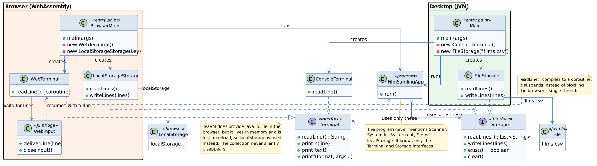
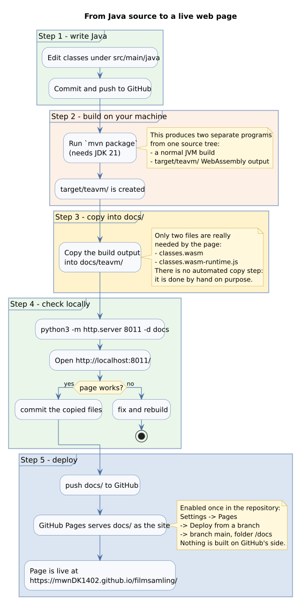

# Filmsamling

Et CRUD-program til en filmsamling — 1. semester, datamatiker, EK.

Filmsamlingen er en digital oversigt over din personlige filmsamling.
Programmet gør det muligt at oprette, vise, søge efter, redigere og slette film
samt registrere, hvornår de sidst er set.

Projektet udvikles som et terminalprogram i Java med fokus på objektorienteret
programmering, unit testing, fejlhåndtering, fillagring og sortering.

## Gruppen

| Fornavn | GitHub                                        |
|---------|-----------------------------------------------|
| Nikita  | [NikitaM2527](https://github.com/NikitaM2527) |
| Mathias | [mwnDK1402](https://github.com/mwnDK1402)     |
| Nikolas | [NikolasCCT](https://github.com/NikolasCCT)   |

---

## Indholdsfortegnelse

1. [Kør programmet](#1-kør-programmet) — det daglige arbejde
2. [Arkitektur](#2-arkitektur) — hvordan koden hænger sammen
3. [Teknologistak](#3-teknologistak) — hvad de enkelte dele er
4. [Browser-versionen](#4-browser-versionen) — byg og test lokalt
5. [Deploy til GitHub Pages](#5-deploy-til-github-pages) — fra kode til live-side
6. [Kendte begrænsninger](#6-kendte-begrænsninger) — læs før du bruger `printf`

---

## 1. Kør programmet

Programmet er et helt almindeligt Java-terminalprogram. Det er den version, der
arbejdes med til daglig.

```sh
mvn compile exec:java -Dexec.mainClass=org.example.Main
```

Afbryd med `Ctrl+D` (Unix) eller `Ctrl+Z` efterfulgt af Enter (Windows).

> **Bemærk:** klassen hedder `org.example.Main` — ikke bare `Main`. Den ligger i
> pakken `org.example`, og Maven skal have det fulde navn.

---

## 2. Arkitektur

Al programlogik ligger i **én** klasse, `FilmSamlingApp`. Den kender kun
interfacet `Terminal` og indeholder derfor hverken `Scanner`, `System.in` eller
`System.out`. Det er hele pointen: programmet ved ikke, om det kører i en
terminal eller i en browser.



Der findes to implementeringer af `Terminal`:

| Klasse            | Bruges af     | Læser input via                        |
|-------------------|---------------|----------------------------------------|
| `ConsoleTerminal` | `Main`        | `Scanner(System.in)` — den rigtige konsol |
| `WebTerminal`     | `BrowserMain` | xterm-terminalen i `docs/index.html`   |

De to indgangspunkter gør nøjagtig det samme — vælger en terminal og starter
`FilmSamlingApp`:

```java
// Main.java — desktop
new FilmSamlingApp(new ConsoleTerminal()).run();

// BrowserMain.java — browser
new FilmSamlingApp(new WebTerminal()).run();
```

Forskellen mellem desktop og browser er altså **kun** hvilken terminal der
sættes ind. Programmet opfører sig ens.

### Interfaces kontrakt

```java
public interface Terminal {
    String readLine();                        // null når input slutter
    void println(String line);
    void print(String text);
    void printf(String format, Object... args);
}
```

`FilmSamlingApp` bruger kun disse fire metoder. Skal der tilføjes noget nyt
(lytterfarver, ryd skærm, spørg om bekræftelse), er det her, det skal ind — ikke
i `System.out` rundt omkring i koden.

### Hvorfor et interface og ikke bare `System.out`?

Browseren kan ikke blokere. På én gang skal den tegne siden, lytte efter
tastetryk og køre Java. Hvis Java-koden stod stille og ventede på et tastetryk,
ville hele siden fryse.

`WebTerminal.readLine()` løser det ved at blive kompileret til en **coroutine**:
kaldet suspenderer stille, siden kører videre, og Java genoptages præcis hvor
det slap, når brugeren trykker Enter. Set fra `FilmSamlingApp` ser det ud som et
helt almindeligt blokerende kald.

Det er den eneste grund til, at interfacet findes. Uden browser-versionen kunne
koden have brugt `Scanner` direkte.

### Browser-specifik kode

Kun to klasser ved, at en browser findes:

- `WebTerminal` — implementerer `Terminal` oven på siden
- `WebInput` — modtager linjer fra siden og vækker den ventende coroutine

Ingen andre klasser i projektet nævner browseren.

---

## 3. Teknologistak

| Del                     | Hvad det er                                              | Hvorfor                                        |
|-------------------------|----------------------------------------------------------|------------------------------------------------|
| **Java 21**             | Selve programsproget                                     | `var`, tekstblokke, switch-udtryk              |
| **Maven**               | Byggværktøj                                              | Henter afhængigheder, kører `mvn package`      |
| **TeaVM 0.16.0**        | Oversætter Java-bytecode til **WebAssembly**             | Så Java kan køre i browseren uden en server     |
| **xterm.js 5.3.0**      | Terminal-emulator i JavaScript                           | Tegner terminalen i `docs/index.html`           |
| **GitHub Pages**        | Gratis statisk webhotel                                  | Serverer `docs/` som en hjemmeside              |

TeaVM er ikke en virtuel maskine og ikke en Java-applet. Det er et
**kompilator-trinn**: Java-klasserne bliver oversat til én `.wasm`-fil, som
browseren afvikler direkte. Der kører ingen Java på serveren — der findes slet
ingen server.

### To programmer fra én kildekode

```sh
mvn package
```

kompilerer kildekoden **to gange**:

| Resultat                | Teknologi        | Startes af                      |
|-------------------------|------------------|---------------------------------|
| `target/*.jar`          | Almindelig JVM   | `mvn exec:java`, `java -jar`    |
| `target/teavm/*.wasm`   | WebAssembly      | `docs/index.html` i browseren   |

Det er samme kildekode begge gange. Kun indgangspunktet er forskelligt:
`Main` for JVM'en, `BrowserMain` for browseren.

### Hvad TeaVM ikke kan

TeaVM har sin egen udgave af Java's standardbibliotek, og den er **ikke
komplet**. Blandt andet findes `java.util.Scanner` ikke, og `System.in` kan ikke
læse noget. Det er præcis derfor, arkitekturen med `Terminal`-interfacet er
nødvendig: browser-versionen skal aldrig i nærheden af de klasser.

---

## 4. Browser-versionen

Browser-versionen er et **ekstra lag** oven på programmet. Den ændrer ikke ved
terminaludgaven, og teamet behøver ikke forholde sig til den til daglig.

Der er bevidst **ingen automatisk kopiering**. Bygger man browser-versionen, er
det en bevidst handling, man selv udfører.

### 4.1 Byg og kopiér

```sh
mvn package
```

Det er **alt**. Kommandoen gør to ting:

1. Oversætter Java-koden til WebAssembly i `target/teavm/`.
2. Kopierer automatisk de to nødvendige filer videre til `docs/teavm/`, hvor
   siden læser dem.

Man behøver altså ikke selv kopiere noget — heller ikke efter ændringer i
Java-koden. Bygger man, følger siden med.

| Fil                       | Nødvendig? | Indhold                               |
|---------------------------|-----------|---------------------------------------|
| `classes.wasm`            | **ja**    | Selve det kompilerede program          |
| `classes.wasm-runtime.js` | **ja**    | Loader, der starter `.wasm`-filen      |

Kopieringen er sat op i `pom.xml` (`copy-web-build-to-docs`) og kopierer kun
disse to filer. `classes.wasm.map` og `classes.wasm.teadbg` bruges kun til
fejlfinding, hentes aldrig af siden, og kopieres derfor ikke.

> **Bemærk:** fordi kopieringen sker automatisk, ændrer `mvn package` filer inde
> i `docs/teavm/`. Det er meningen: byg, og commit derefter. Har man kun bygget
> for at tjekke, at koden kompilerer, kan man fortryde ændringen med
> `git checkout docs/teavm`.

### 4.2 Test lokalt

```sh
python3 -m http.server 8011 -d docs
```

Åbn <http://localhost:8011/>.

En simpel filserver er nok, fordi alt er statiske filer. Browseren henter
`.wasm`-filen som en helt almindelig fil.

> **Vigtigt:** siden skal åbnes via `http://`, ikke ved at dobbeltklikke på
> `index.html`. Åbner man filen direkte (`file://`), nægter browseren at hente
> `.wasm`-filen.

Tryk `Ctrl+C` i terminalen for at stoppe serveren.

### 4.3 Hvad sker der på siden?

`docs/index.html` gør tre ting:

1. **Tegner terminalen.** Opretter en `xterm.js`-terminal i `<div id="terminal">`.
2. **Starter Java.** Henter `classes.wasm` og kalder programmets `main`.
3. **Forbinder tastatur og program.** Når Java venter på en linje, sender siden
   den indtastede linje ind i Java via `WebInput.deliverLine(...)`.

---

## 5. Deploy til GitHub Pages

GitHub Pages serverer statiske filer fra et git-repository. Der er **ingen
server involveret**: GitHub lægger blot filerne ud, som de er. Det passer
perfekt, fordi browser-versionen netop er statiske filer.



> **Status:** browser-versionen ligger i øjeblikket kun på grenen `xterm`, og
> `docs/` findes ikke på `master`. Pages skal derfor sættes op, efter grenen er
> flettet ind — se trin 4.

### 5.1 Få koden ind på standardgrenen

Pages serverer fra én gren. Den skal indeholde `docs/`:

```sh
git checkout master
git merge xterm
git push origin master
```

### 5.2 Slå Pages til (gøres én gang)

1. Gå til repository'et på GitHub: <https://github.com/mwnDK1402/filmsamling>
2. **Settings** → **Pages** (i menuen til venstre)
3. Under **Build and deployment** → **Source**: vælg **Deploy from a branch**
4. Under **Branch**: vælg `master` og mappen **`/docs`**
5. Tryk **Save**

### 5.3 Vent og åbn

Det tager typisk et par minutter første gang. Siden ligger herefter på:

**<https://mwnDK1402.github.io/filmsamling/>**

### 5.4 Fremover: opdatér siden

```sh
mvn package
git add docs/teavm
git commit -m "Update the browser build"
git push
```

`mvn package` kopierer selv de nye filer til `docs/teavm/`, så der er ingen
manuel kopiering. GitHub opdager ændringen og opdaterer siden inden for et
minuts tid.

### Om stier på siden

Alle stier i `docs/index.html` er **relative** (`./teavm/classes.wasm`, ikke
`/teavm/classes.wasm`). Det er nødvendigt, fordi siden ikke ligger på
`mwnDK1402.github.io/`, men i en undermappe:

```
https://mwnDK1402.github.io/filmsamling/   <-- undermappe!
```

Med en absolut sti ville browseren lede efter filen på
`mwnDK1402.github.io/teavm/...`, hvor den ikke findes. Brug derfor altid `./`
i nye stier.

### Alternativ: GitHub Actions

Kopieringen sker nu lokalt som en del af `mvn package`. Man kan gå et skridt
videre og lade GitHub bygge og udgive siden ved hvert push med en GitHub
Actions-workflow. Det er ikke gjort her, fordi den lokale kopi er nemmere at
gennemskue: det, der ligger i `docs/`, er præcis det, der bliver vist, og man
kan se ændringen i git, før den ryger ud.

Reprojektet har i forvejen `.github/workflows/maven-publish.yml`, men den bygger
kun en `.jar` ved en release — den rører ikke `docs/`.

---

## 6. Kendte begrænsninger

### `printf` er dyr i browseren

`Terminal.printf` bruger samme formatstrenge som `String.format`. Det virker,
men TeaVM skal trække en hel formateringsmaskine med ind i `.wasm`-filen:

| Situation                          | Størrelse på `classes.wasm` |
|------------------------------------|-----------------------------|
| `printf` findes, men bruges ikke   | ca. 22 KB                   |
| `printf` bruges ét eller flere steder | ca. 227 KB               |

Spring derfor `printf` over, hvis almindelig streng-sammensætning er nok.
Beløbet betales kun én gang, uanset hvor mange steder det bruges.

### Tre formateringskoder mangler i browseren

Disse kaster `UnknownFormatConversionException` i browseren, men virker fint på
desktop:

| Kode | Betydning            | Brug i stedet   |
|------|----------------------|-----------------|
| `%n` | linjeskift           | `"\n"`          |
| `%e` | videnskabelig notation | `%f`          |
| `%t` | dato/tid             | formater selv   |

**`%n` er den farlige**, fordi den er den idiomatiske måde at afslutte en
formateret linje på — og den fejler kun i browseren, ikke på desktop.

Alt andet fungerer ens: `%d`, `%s`, `%f`, `%-10s`, `%05d`, `%x`, `%X`, `%o`,
`%b`, `%c`, `%%` og `%,d`.

### Klassenavne på GitHub

Hvis Pages giver 404 på forsiden, skyldes det oftest, at mappen ikke indeholder
en `index.html` i roden. `docs/index.html` er forsiden — filen skal hedde
præcis det og ligge direkte i den mappe, der er valgt under Pages-indstillingerne.

---

## Fejlfinding

| Symptom                                   | Årsag og løsning                                                        |
|-------------------------------------------|-------------------------------------------------------------------------|
| Siden er tom / fejlbesked om wasm         | `docs/teavm/classes.wasm` mangler. Kør `mvn package`.                    |
| Ændringer i Java slår ikke igennem        | Glemt at bygge. Kør `mvn package` (den kopierer selv til `docs/teavm/`). |
| `file:///...` virker ikke                 | Siden skal køre via `http://`. Kør trin 4.2.                             |
| `Could not find or load main class`       | Brug det fulde navn: `-Dexec.mainClass=org.example.Main`.                |
| 404 på GitHub Pages                       | `docs/index.html` mangler på den gren, Pages serverer fra. Se trin 5.    |
| `UnknownFormatConversionException`        | `%n`, `%e` eller `%t` brugt i browseren. Se afsnit 6.                    |
